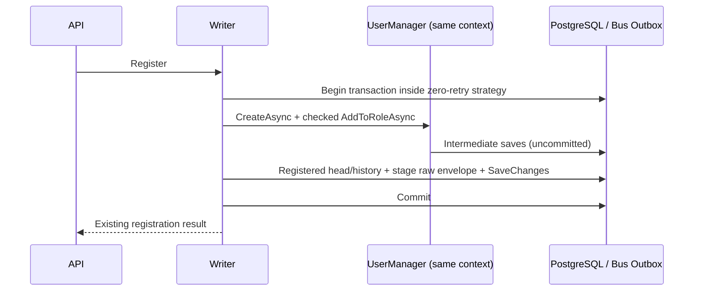

# Implementation Plan: Authoritative Customer Facts Producer

**Change**: `003-authoritative-customer-facts-producer` | **Date**: 2026-10-26
**Status**: Proposed design for review; no implementation/migrations run.
**Spec**: [spec.md](spec.md) | **Tasks**: [tasks.md](tasks.md)

## 1. Baseline, ownership and constitution check

| Repository | Local checkout inspected | Remote default verified with ls-remote; source of code evidence |
| --- | --- | --- |
| Loyalty (L) | `chore/code-quality-tooling`, `e1d2e0d60c761cfa600891a9390138993292cc2a`; untracked `specs/002-authoritative-customer-facts/` | master `5ae3ad188f09edabcb7f2f81142a77271b385245` (merged PR 2A) |
| Backend (B) | `fix/gold-checkout-compensation`, `7aa5a5c5f9e5bdf7ad0b69feb8e1e48b2681253d`; clean | main `f5bb441d8a7c8fe9be4bcda73a457c4ce6fb4f43` |

Remote loyalty master was fetched without switching branches. Committed code was read with `git show`/`git grep` at the full remote SHAs, not assumed equal to local checkout. B current branch differs substantially from main and is not the implementation base. Future separately authorized implementation uses an isolated B worktree from freshly checked origin/main. Do not merge/cherry-pick the old branch as a setup step.

L is the sole SDD root. Pass read-only absolute paths to these three artifacts, constitution and master into the future backend session; do not copy the master or install Spec Kit in B. `002` remains prior PR A/B planning history. This more specific producer plan supersedes only its producer implementation instructions, notably **no new public correction API**. PR 2A implementation/contract remains unchanged.

Applied `speckit-specify → speckit-plan → speckit-tasks` responsibilities using existing templates. Per user/constitution, research/model/contracts/quickstart are consolidated here; no setup script, Git hook, branch creation, implementation or feature-pointer update is necessary. No extensions.yml exists. Constitution I–VII: one backend PR; same PostgreSQL/context; retained identity; existing Bus Outbox; real PG/transport gates; no new framework/infra or unauthorized operations. No constitutional waiver proposed.

## 2. Evidence-based current state

References are repository-relative at the baseline above. `B/` and `L/` identify separate repositories, not new directories.

| Evidence | Confirmed behavior / limitation |
| --- | --- |
| B `src/Modules/Identity/Cinema.Identity.Domain/User.cs:5–9` | Public FirstName/LastName/DateOfBirth; no registration timestamp, first-set timestamp or facts revision |
| B `src/Cinema.Infrastructure/Services/IdentityService.cs:16–36` | Register creates Identity user, then assigns User role in a separate call; ignores AddToRole result; no surrounding transaction, source fact or outbox |
| B `src/Cinema.Application/Auth/Commands/RegisterUser/RegisterUserCommand.cs` and Host AuthController | Single public registration flow delegates to that service; no registration idempotency key |
| B `.../SetMyDateOfBirth/SetMyDateOfBirthCommandHandler.cs:30–67` | Rejects existing DOB, normalizes requested .Date to UTC, stages legacy DOB before UpdateAsync; occurrence time generated in handler, not retained |
| B `.../UpdateProfile/UpdateProfileCommandHandler.cs:30–90` | Omitting DOB retains current date; different existing date rejected; same calendar date allowed; first value plus generic profile message staged before UpdateAsync |
| B `src/Cinema.Infrastructure/ConfigureInfrastructureServices.cs` | Identity stores and IApplicationDbContext use scoped ApplicationDbContext; MassTransit 8.5.5 uses UsePostgres/UseBusOutbox and raw JSON; explicit queue send used for loyalty |
| B `.../Persistence/ApplicationDbContext.cs`, `.../DatabaseContextConfiguration.cs` | SaveChanges override delegates to EF; production Npgsql EnableRetryOnFailure(3); same context also tracks MassTransit outbox tables |
| B `tests/Cinema.OrdersTests/OrderReservationPostgresTests.cs:458–567` | Existing identity+outbox PG regression covers commit, staging failure and explicit rollback for legacy DOB; not new facts, roles, concurrent DOB or production-retry transaction semantics. Fixture `retries` defaults false |
| B `.../Migrations/ApplicationDbContextModelSnapshot.cs:720–727` | Identity ConcurrencyStamp exists; unique NormalizedUserName, nonunique NormalizedEmail; API registration sets UserName=email. Do not claim DB unique email across every hypothetical username |
| B `.../Persistence/Interceptors/DispatchDomainEventsInterceptor.cs` | Domain notifications deferred for explicit transactions; User is IdentityUser, not BaseEntity with a registration domain event. Do not assume a new fact is staged automatically |
| L DTO/service/consumer and `docs/reliability.md`, at `5ae3ad1` | Explicit v1 validation; profile-lock then immutable receipt/projection transaction; durable gaps, BLOCKED contradictions, fair bounded recovery; transport budget/quarantine and lost-ACK tests already present |

Role assignment failure leaving a created user is a confirmed code path (not runtime-reproduced here). Missing timestamps/history are confirmed design limitations. Partial source/outbox persistence after future changes is a risk to prevent, not a claim that current DOB staging is already broken. Existing PG tests are inspected, not rerun.

## 3. Complete relevant Identity write-path inventory

Search coverage: production `src/` for UserManager, CreateAsync/UpdateAsync, new User, DateOfBirth assignment/SetProperty, Users/Set<User> writes, seed entry points; tests inspected separately. No production import, external-login registration, direct EF user Add/Update or DOB clear/correction writer found beyond these paths. Direct SQL outside repository is unknown.

| Path / entry | Persistence | Current event | Atomicity now | Required producer change |
| --- | --- | --- | --- | --- |
| POST `/api/auth/register` → RegisterUserCommand → IdentityService.RegisterAsync | CreateAsync then AddToRoleAsync, same scoped EF store | None | Two saves, no outer transaction; role result ignored | Account+required role+Registered revision+outbox in one transaction; check both results |
| PATCH `/api/account/profile/date-of-birth` and `/api/users/me/date-of-birth` → same SetMyDateOfBirth handler | Find/guard/UpdateAsync | USER_DATE_OF_BIRTH_SET → loyalty_ticket_purchased | Legacy send staged before Identity save; tested basic atomic save | Lock/reload latest user before guard; first-set time/revision/history/new+legacy outbox together |
| PUT `/api/account/profile` → UpdateProfile handler | Name fields and optional DOB via UpdateAsync | user.profile_updated always; legacy DOB on null→date | Existing staging-before-save; not serialized between handlers | Same facts-writing transaction for first DOB; same-date/omitted DOB no new revision; retain generic message |
| Config-enabled IdentitySeeder.SeedAsync → Host SeedIdentityIfEnabledAsync | CreateAsync then AddToRoleAsync(Admin) | None | Separate saves | New admins use same registration operation with Admin role; existing users/role repair do not fabricate registration |
| Development InitialiseDatabaseAsync → ApplicationDbContextInitializer.TrySeedAsync | Default admin CreateAsync then role; unrelated demo catalog saves | None | Separate saves, result not fully checked | Only new-admin portion uses same operation; do not make catalog seeding one giant transaction |
| UserService.ChangeRoleAsync (admin) | RemoveFromRoles/AddToRole | None | Separate saves | No customer revision for role-only changes. Preserve facts columns/Identity concurrency; no role-system redesign |
| ChangePassword handler; Login/Refresh | Identity password update / separate refresh-token rows | None | Existing behavior | No customer revision; ensure ordinary Identity saves cannot stale-overwrite protected metadata; auth/refresh refactor excluded |
| ConfigurePersistenceServices.AddPersistenceServices | Alternate Identity/DbContext registration helper; no current production caller found | None | Not a mutation entry point | Do not activate/refactor it; verify primary host wiring and document DI scope assumptions |
| Tools/Cinema.DbUpdater `--seed` | SeedOperations currently no-op | None | No Identity mutation | Do not infer another registration path; future explicit restage mode must not run default migration/seed path |
| Test fixtures (`Users.Add`, new User in Orders/Phase5/etc.) | Direct EF, test-only | None | Fixture-specific | Keep deliberate legacy-unknown fixtures; use real UserManager for new producer regressions |

There is **no current supported clear or admin DOB correction path**. Different self-service DOB fails; null UpdateProfile retains DOB. The two validators differ (SetMyDOB allows today and bounds 120 years; UpdateProfile requires at least 10 years). Preserve each rule; unifying age policy would be a separate business change.

## 4. Proposed minimal data model and alternatives

### A. Extend User head + one immutable source-history table — recommended

Add nullable `RegisteredAtUtc`, nullable `DobFirstSetAtUtc`, integer `CustomerFactsRevision` default 0 to User, with narrow facts mutation methods. Keep Identity's required public inherited setters; do not redesign Identity. Protect custom timestamps/revision from ordinary stale updates (explicit EF modified properties/after-save immutability plus concurrency checks, verified in tests). Do not globally mark revision concurrency in a way that lets a profile read silently override it.

Add one `CustomerFactRevision` entity in existing transitional Domain (no new project/dependency from Identity.Domain), mapped by ApplicationDbContext:

- eventId UUID PK, userId FK to actual EF-mapped users table, revision positive int; UNIQUE(userId, revision).
- Immutable **complete v1 snapshot/envelope**, retained as canonical serialized JSON text so exact source bytes can be restaged. Identity and timestamp columns needed for lookup must agree with that snapshot; do not maintain a second hand-built payload on replay.
- Correction-only operationId unique (nullable filtered unique), actorUserId, nonempty reason, expectedRevision and previous/new DOB in retained snapshot. The immutable successful snapshot supplies historical command result; replay checks actor + normalized request content before expected-current-revision validation.
- Snapshot captured after validation/lock and normalized once to UTC milliseconds. History persists beyond MassTransit outbox cleanup. No payload in logs.
- EF custom columns map explicit names/types/precision in UserConfiguration, respecting Identity's actual `AspNetUsers` mapping (do not assume `asp_net_users`). Use timestamptz(3) and explicit UTC conversion. No DB `now()` default for historical columns.
- Audit not editable through ordinary providers: encapsulated entity, no update/delete API, reject Modified/Deleted entries for this entity in existing persistence boundary. DB PK/unique/FK/check constraints enforce identity/shape; database-owner SQL bypass is outside application guarantees. No trigger framework needed.

State: new registration commits revision1 Registered; first DOB revision2 DateOfBirthSet. Legacy revision0/DOB-null can start revision1 DateOfBirthSet with registeredAtUtc=null; existing legacy DOB stays unknown until a genuine controlled correction can start revision1 DateOfBirthCorrected with null historical instants. No synthetic Registered event for old accounts. Supported correction never clears DOB or resets first-set time.

**Problem → cause → solution → guarantee → trade-off**: Need source state plus restageable identity after outbox cleanup → current User has only mutable DOB → small User head and immutable revision snapshots → lockable source and stable replay → intentional duplication of current head and historical snapshots, checked atomically.

### B. Separate source-head + history, User unchanged except DOB

Store timestamps/revision in CustomerFactsState (userId PK) plus same history table. Allows isolation from Identity's shape, but every writer must lock User then upsert/lock a second row and coordinate User DOB with source head; requires another model/table/unknown-root initialization. No demonstrated need for that extra state boundary. Pure User-only timestamps with no retained history is smaller but **insufficient**: delivered outbox rows are not permanent audit/recovery evidence.

The source model is not event sourcing: current Identity state remains authoritative, no reconstruction engine or separate write/read service is introduced. All account/fact changes stay in the existing database.

## 5. Transaction boundary and execution strategy

Introduce a small infrastructure-local customer-facts writer/coordinator with an Application interface **only because registration, both DOB handlers and seeders need the same atomic operation**. Example paths: `Common/Interfaces/ICustomerFactsWriter.cs`, `Infrastructure/Services/CustomerFactsWriter.cs`. It owns top-level transactions; helpers only stage using the same scoped context/send provider. No hidden independent transaction in stage/replay helpers.

Registration: obtain server UTC instant once inside accepted operation, normalize to milliseconds; explicit transaction; CreateAsync; check result; assign required existing role; check result; persist head/history, stage fact via scoped ISendEndpointProvider; final SaveChanges; commit. Intermediate Identity saves are enclosed by that transaction. Do not take the current instant on delivery or claim knowledge of an exact future physical commit timestamp. Only successful commit makes the chosen source instant authoritative. Registration does not generate a DOB or generic-profile message.

DOB: begin transaction → lock mapped User row by PK (`FOR UPDATE`) → **reload** tracked user under lock (UserManager may already track stale data) → read/validate current DOB and source head → dedupe/no-op/conflict → allocate n+1 → set time once → history snapshot/new outbox plus legacy messages → Identity UpdateAsync and final SaveChanges → commit. Consistent order: User → source history/operation uniqueness → outbox; one user per transaction. Correction checks exact historical operation replay before stale expected revision; otherwise same lock and atomic writes. Restage reads immutable history and stages only that original new passive envelope; it does not update User or generate legacy financial messages.

No automatic replay of the multi-save callback. Production EnableRetryOnFailure would reject a bare user transaction. Follow the existing `CheckoutExecutionStrategy` zero-retry ExecutionStrategy pattern with an **infrastructure-local** `CustomerFactsExecutionStrategy` around begin/body/commit, avoiding a new Identity→Orders dependency or generic strategy framework. Scope of ExecutionStrategy.Current must cover every nested Identity SaveChanges and outbox save; reject an outer retrying callback. Global Npgsql retry configuration stays enabled. Connection/conflict errors can be retried as a fresh request/scope after diagnosis; no reused failed ChangeTracker and no implicit new revision.

This is a proposed mechanism, not verified runtime behavior. PG tests with real Identity, Bus Outbox and `EnableRetryOnFailure(3)` are mandatory before accepting it. Check runtime store DbContext identity; a second DbContext/send provider outside the scoped bus outbox is a test failure.

Rollback returns Result failures for rejected operations; dispose transaction and request scope without later saves. Exceptions abort the operation. Stage failure must not leave queued messages in a scope subsequently saved by another path. Catching and continuing to unrelated SaveChanges in that failed scope is prohibited. Commit exception is ambiguous: fresh-scope inspection by durable user/revision/operation identity; do not assert rollback or automatically re-execute. Existing duplicate registration/SetMyDOB responses remain; a general HTTP command-result store is out of scope.

**Problem → cause → solution → guarantee → trade-off**: Multi-save UserManager+role isn't one operation → implicit per-save commits and retrying provider → explicit transaction inside supported zero-retry scope → all-or-none before confirmed commit, no accidental callback replay → transient request can fail; unknown commit still requires inspection. No email/RPC/broker call inside callback; scoped outbox Send must be demonstrated DB-only while broker is down.

## 6. MassTransit delivery, revision and replay

Retain `AddEntityFrameworkOutbox<ApplicationDbContext>().UsePostgres().UseBusOutbox()`, scoped ISendEndpointProvider, UseRawJsonSerializer and explicit `queue:loyalty_ticket_purchased`. Do not use IBus/direct channel or move staging to post-commit network work. Existing IPublishEndpoint email/payment routes are not changed. UserManager.CreateAsync/UpdateAsync may save early; only the enclosing transaction couples their writes to final source-history/outbox staging.

Generate eventId once per accepted revision and store it. Revision allocation uses locked head+1, checked against Int32.MaxValue; unique constraints arbitrate identity. Failed transaction consumes no committed revision. Do not use delivery ID/MessageId or a nontransactional DB sequence as per-user contiguous revision. Set AMQP MessageId to eventId for correlation, but consumer authority remains data.eventId/(userId,revision). Distinguish automatic delivery retry of the serialized outbox from explicit restaging of a retained source snapshot.

Minimal operator replay: add a narrowly scoped `--restage-customer-fact <eventId>` mode to existing `src/Tools/Cinema.DbUpdater/Program.cs`, delegated to a focused `CustomerFactReplayOperations.cs`. Dispatch this mode **before** default migration/seed path; it must apply no migration or seed. Resolve DB plus scoped Bus Outbox configuration without connecting Redis/SMTP/other application services; stage original stored JSON with its original eventId/MessageId and SaveChanges in a short transaction. Reuse MassTransit registration options where practical; no new always-running publisher/service. Missing/invalid history fails safely. Tests must confirm raw JSON isn't wrapped or JSON-string double-encoded by this path; choose supported raw-body serialization preserving exact stored semantics. If existing APIs cannot stage the stored envelope directly, deserialize the fixed v1 type from retained canonical payload and prove exact semantic equality rather than inventing a serializer abstraction. Replay can duplicate delivery and is explicit operator action, not automatic reset of consumer quarantine budgets.

Internal correction method takes userId, new calendar DOB, expected revision, operationId, actor and reason under a trusted support boundary. Do not expose it as a new controller or unauthenticated CLI. No current production caller is silently converted to a correction path. Unique operation identity and audit are implemented/tested foundations; an actual support entry point requires separate authorization. Revision cannot change for role/name/password-only updates. Clearing unsupported by v1, reject without source/outbox change.

## 7. Fixed .NET → NestJS v1 contract matrix

Authority: L `src/loyalty/dto/customer-facts-changed.dto.ts:4–76`, `customer-facts.service.ts`, merged migration and actual RMQ tests. No reader change is proposed.

Envelope: raw JSON `{ "pattern": "CUSTOMER_FACTS_CHANGED", "data": { ... } }`. Use explicit JsonPropertyName for envelope and payload; no reliance on global .NET naming. Durable inbound queue is RMQ_QUEUE (default `loyalty_ticket_purchased`), explicit backend queue send; not `loyalty.events` (outbound from loyalty). Keep existing durable declaration, noAck=false, configured finite prefetch and inbound retry/quarantine; actual deployed queue/policies are not inferred from fixtures.

| Data field | JSON/.NET representation | Required/nullability and validation |
| --- | --- | --- |
| schemaVersion | integer | Required, exactly 1 |
| eventId | Guid formatted D, lowercase | Required hyphenated UUID; reader accepts either case, canonicalizes lowercase; no UUID-version restriction imposed |
| userId | Guid D, lowercase | Required same UUID rule; stable Identity User.Id |
| revision | int | Required 1…2147483647 |
| kind | explicit string | Required Registered / DateOfBirthSet / DateOfBirthCorrected; no numeric enum JSON |
| occurredAtUtc | canonical string | Required `yyyy-MM-dd'T'HH:mm:ss.fff'Z'`, year 0001…9999 |
| registeredAtUtc | same string or null | Property required; null only for unknown evidence, never delivery/profile-created time |
| dobFirstSetAtUtc | same string or null | Property required; stays original or explicitly unknown on corrections |
| dateOfBirth | `yyyy-MM-dd` string or null | Property required, real calendar date including leap day, no time/offset |
| previousDateOfBirth | same calendar date or null | Property required; previous nonnull date only on correction |
| correctionOperationId | Guid D or null | Property required; present nonnull on correction only |

Configure explicit null inclusion even if host serializer later changes. .NET default UTC formatting can omit .000 or include 7 fractional digits; it **does not guarantee this reader's canonical form**. Normalize source instant once to millisecond precision before persistence and serialize with fixed invariant format. `DateTimeUtcConverter` currently lives in Scheduling.Infrastructure (namespace retained Infrastructure.Persistence.Converters); it converts UTC but does not enforce milliseconds. Do not use .ToUniversalTime on an Unspecified date-of-birth as though it were an instant; normalize DOB calendar once. DOB validators remain route-specific.

| Kind | Intrinsic reader rule | Predecessor rule / intended producer transition |
| --- | --- | --- |
| Registered | revision=1; registeredAtUtc=occurredAtUtc; all DOB/previous/correction fields null | New account only; no later Registered revision |
| DateOfBirthSet | date nonnull; firstSet=occurred; previous/correction null | Later revision requires prior DOB and firstSet null, same registration. Legacy first fact may be revision1 with registration null |
| DateOfBirthCorrected | date and previous nonnull/different; operationId nonnull | Later revision must match previous DOB and unchanged registration/firstSet. Legacy root correction allowed with truthful unknown instants; no clear/no-op correction |

Reader accepts explicit unknown revision1 root; it doesn't prove historical registration. It doesn't validate every chronological/age relation; producer must not loosen its own route validation merely because wire schema accepts a value. Unknown metadata is stripped; do not send actor/reason/email in public envelope. Retain restricted support audit locally.

Reader dedupe: eventId PK and unique(userId,revision), normalized semantic payload comparison (key order/UUID case tolerated); exact repeat returns. Changed identity/content → permanent CUSTOMER_FACT_IDENTITY_CONFLICT, durable existing transport quarantine. Gap → PENDING+ACK after durable receipt; next revision applied only contiguously, max50 per-user transaction. Contradictory predecessor → BLOCKED, last valid projection retained. Recovery max50 users/pass, keyset/wrap, per-user isolation, existing profile lock/retry. BLOCKED/missing history cannot be force-skipped by producer replay. Real lost-ACK transport regression already exists in PR 2A; manual duplicate publish is separate evidence.

## 8. Compatibility, schema change and rollout

Keep `USER_DATE_OF_BIRTH_SET` (data.userId/dateOfBirth/occurredAtUtc) on first DOB; reuse accepted date and first-set instant, not another clock read. Keep generic UserProfileUpdatedMessage on its current route. Stage both legacy and passive facts in the **same** source transaction. Registration emits only Registered; corrections/replay emit no first-DOB bonus message. Passive reader cannot double-grant; legacy grant dedupe remains necessary and separately tested. No delivery-order dependency between the two flows.

One additive EF migration in the future backend PR: nullable timestamp columns, revision0 default, new source-history table/constraints/indexes, designer/snapshot. No backfill of unknown timestamps or migration-time events. Fresh/prior-schema disposable DB tests preserve old users/DOB exactly. Actual large-table ALTER lock characteristics require operational review if relevant; this is a university project with disposable data, so no dual economy, historical conversion or prolonged mixed-writer compatibility scheme.

Rollout: approve plan → implement/test backend in isolated current-main worktree → separately authorized commits and pinned gates → existing PR 2A schema plus all active loyalty replicas support pattern → stop/drain old backend identity writers → apply additive backend schema → deploy upgraded source writers together → verify registration/first-DOB and backlog. Queue availability/permissions and configured names must match before emission. If reader is not deployed, do not start producer; durable queue alone does not protect against old competing readers rejecting unknown patterns. If broker is down, outbox retains facts. Do not drop/redeclare shared queue.

Code rollback: stop mutations/emission and investigate; old DOB writers could change source without history, so returning to them while continuing customer changes is not a safe transparent rollback. Retain new schema/history. Migration/deployment/reset are not authorized by this planning task.

## 9. Sequence diagrams (proposed)



```mermaid
sequenceDiagram
  participant Handler as Either DOB handler
  participant Writer
  participant DB as PostgreSQL / Bus Outbox
  Handler->>Writer: First DOB request
  Writer->>DB: Begin, lock User, reload current state
  Writer->>Writer: Validate current DOB; allocate revision and fixed instant
  Writer->>DB: User + history + legacy/new staged messages
  Writer->>DB: Identity save / final SaveChanges / commit
  Writer-->>Handler: Existing route result
```

```mermaid
sequenceDiagram
  participant Writer
  participant DB
  participant Broker
  Writer->>DB: Begin; intermediate Identity saves
  Writer->>DB: Stage source history / outbox
  DB-->>Writer: Injected role/save/staging failure before commit
  Writer->>DB: Rollback, dispose failed scope
  Note over DB,Broker: No committed source change or publishable outbox row
  Note over Writer,DB: Commit response loss is a separate ambiguous case; fresh-scope inspection required
```

```mermaid
sequenceDiagram
  participant Writer
  participant DB
  participant Delivery as Existing MassTransit delivery
  participant Broker
  participant L as Passive loyalty reader
  Writer->>DB: Commit User/history/outbox
  Note over Writer: Process crashes before delivery
  Delivery->>DB: Resume durable outbox after restart
  Delivery->>Broker: Original raw envelope
  Broker->>L: At-least-once delivery
  L->>L: Receipt/projection commit then ACK
  Note over Delivery,L: Duplicate remains possible; source identity and consumer dedupe are stable
```

```mermaid
sequenceDiagram
  participant A as DOB request A
  participant DB
  participant B as DOB request B
  A->>DB: Lock User and reload
  B->>DB: Lock same User (wait)
  A->>DB: First DOB + next revision + legacy/new outbox; commit
  DB-->>B: Lock acquired, reload committed state
  B->>B: Existing date: reject different value / preserve route same-value semantics
  Note over B,DB: No losing-value fact or second first-set timestamp
```

## 10. Verification matrix and failure scenarios

All tests below are **future gates**, not results of this planning session.

| Scenario | Required assertions | Level / proposed location | AC |
| --- | --- | --- | --- |
| Contract/date/unit | Every kind and explicit null; uppercase UUID input normalization; .000/7-digit trap; real leap day/invalid date; UTC instant across Kyiv midnight/DST unchanged after reload | B tests/Cinema.OrdersTests/CustomerFactsTests.cs | 02/03/06 |
| Registration create/role fail | Real scoped Identity roles/store; check result; rollback user+role+history+outbox at each injected save/role failure | B CustomerFactsPostgresTests.cs reuse ReservationDatabase/CreateOutboxServices patterns | 01/04 |
| New admin seeding/repeat | Both executable seeders new account fact once; restart/existing role repair no invented timestamps/revision | B CustomerFactsPostgresTests.cs | 01/06 |
| Both DOB writers and aliases | Omitted/null keeps DOB; existing same/different response unchanged; profile generic+legacy+passive records same source; mismatched validators unchanged | B handler unit + PG + focused HTTP probe | 02/08 |
| Concurrent DOB + Identity race | Independent DB scopes; held row lock/observed waiter barrier, not Promise.WhenAll alone; one winning value/revision; no stale metadata overwrite on profile/name/password/role save | B PG with EnableRetryOnFailure and actual store | 02/04 |
| Immutable source + reconstruction | New context reads committed user/history; regenerated envelope semantic/field equality; timestamps unchanged by profile edits; snapshot update/delete rejected | B PG | 03/06 |
| Revision/correction | Positive/unique monotonic revisions, max guard; internal correction expected revision; operation replay after later changes returns original result; conflict actor/payload; A→B→A; no clear; audit private | B unit/PG | 07 |
| Pre-commit rollback | Fail after user save, after staging one legacy message and during final save; fresh scope sees original user/head/history/outbox and later unrelated request has no leaked staged message | B PG | 01/04 |
| Ambiguous commit | Test interceptor lets actual commit happen then throws before caller observes success; fresh scope proves one source record, repeat cannot duplicate; failed commit not presumed rollback | B PG using production retry config | 04 |
| Serialized retry | Inspect original OutboxMessage body, retry/restart delivery, compare identity/time/content; no reconstruction from now | B PG + real RMQ | 03/05 |
| Stored-history replay | After delivered outbox removed, restage retained fact in fresh scope; same envelope/id/revision; only new passive outbox, no user/legacy effect; tool mode does not migrate/seed | B PG/CLI + RMQ | 03/05 |
| Broker outage + crash | Controlled disposable broker stop/network isolation; DB mutation/outbox commits; restart actual delivery host, recover same stored fact; bounded polls with deadline, no long arbitrary sleeps | B real RMQ/PostgreSQL | 05 |
| Duplicate vs lost ACK | Manual republish proves semantic dedupe; separately real channel-close barrier after independently observed L commit before ACK, require redelivered flag and same body/eventId | Reuse L test/rmq/customer-facts.transport-spec.ts fixture in final compatibility gate | 05/08 |
| Revision order/conflict | Stored produced facts delivered 3→1→2; strict PENDING recovery; changed same identity quarantined, contradictory successor BLOCKED; valid other user progresses | Pinned B+L real transport; correction fixture from internal method | 08 |
| Current economy | New facts zero financial effect; legacy initial-DOB grant occurs at most once despite duplicate/delivery order; existing DOB consumer remains authoritative for current birthday state | Pinned B+L PG/RMQ/E2E | 08 |
| Fresh + upgrade schema | Apply future migration only in disposable DB; old DOB/null instants preserved; no synthetic history; EF model matches migration | B PG, DbUpdater tests | 06/09 |

Before commit: run backend `dotnet build Cinema.sln -c Release`, required full `dotnet test Cinema.sln -c Release` with repository test infrastructure/env (verify CINEMA_TEST_POSTGRES_CONNECTION/RabbitMQ are disposable); focused customer facts tests must actually execute, not skip due missing env. Reuse OrdersTests existing EF/Identity/Bus Outbox and resource setup; no new test framework. Document exact commands, cases, skips and cleanup. L production checks are not substituted for backend tests.

After separately authorized commits: clean B implementation SHA + clean L master SHA including PR 2A; record pair. Existing B `LOYALTY_REPO=<L> bun tests/checkout-e2e/run.mjs` currently selects only checkout.transport-spec.ts, so it does **not** automatically run a new customer facts E2E. Extend its explicit allowlisted selection minimally or add an explicit focused invocation within the same disposable stack. L `MONOLITH_REPO=<B> bun run test:transports` uses its own runner and must be inspected similarly. New customer-facts probe can live in B `tests/checkout-e2e/customer-facts-probe.mjs` using real HTTP + restricted DB/broker fixture, avoiding an application-code change in L. Auth APIs lack correction route: seed corrections through the tested internal fixture, do not pretend to exercise a nonexistent support HTTP API.

Run gates sequentially; no bypass of clean-checkout guard, no dynamic assertion rewriting. PR 2A's existing RMQ suite independently covers its lost-ACK seam; if the final combined harness cannot share that seam, report separate same-SHA evidence rather than claiming the backend E2E demonstrated lost ACK. Payments in checkout runners remain mock-provider behavior. Inspect queue type/version/effective policies from each fixture, not assumed production. Clean only own disposable resources.

## 11. Risks, trade-offs and readiness

- Scoped outbox + Identity auto-saves + zero-retry strategy must be proven together; tests are a release blocker if source/facts can separate. No new distributed transaction.
- Legacy correction without known timestamps is representable, not proof of earlier eligibility. Current economy remains independent and cannot consume passive facts as new bonuses.
- Existing seeders run before app.Start; outbox staging must not require running broker/Bus host. Test that sequence with broker unavailable.
- Ingestion history is privacy-sensitive; keep actor/reason private, safe diagnostics only. Data retention policy not redesigned here.
- Generic profile-update and first-DOB messages remain; compatibility dual publication is justified, no dual economy/dual database.
- New clear/correction public API is excluded, despite older 002 proposal. Future support surface needs explicit authorization; internal tested correction primitives are not claimed as a deployed support feature.
- Required public behavior is fixed. No genuine blocking business ambiguity found. Acceptance of this engineering plan, implementation authorization, real PG/transport results and committed SHA-pair gates remain outstanding.

First reviewable slice: source model/contract plus failing real Identity registration/role/outbox regressions, then atomic registration wiring in the same backend PR. Do not deploy a model-only producer or close the PR before both DOB routes/seeders and recovery gates are complete.
